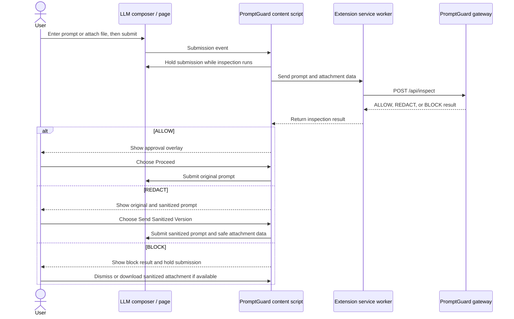
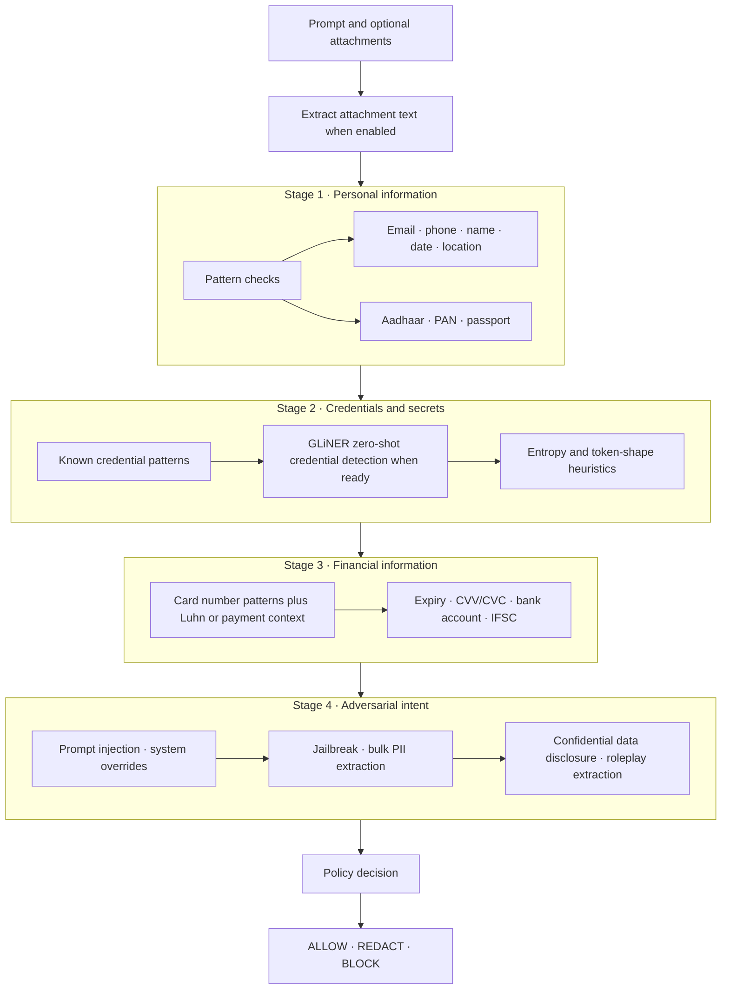

# PromptGuard Browser Extension

PromptGuard is a Chrome Manifest V3 extension that inspects prompts and supported attachments before they are sent from selected web-based LLMs. It sends content to the PromptGuard gateway at `http://localhost:8000` and applies the gateway's `ALLOW`, `REDACT`, or `BLOCK` decision.

## Supported sites

- ChatGPT: `chatgpt.com`, `chat.openai.com`
- Claude: `claude.ai`
- Google Gemini: `gemini.google.com`
- Mistral Le Chat: `chat.mistral.ai`
- Groq: `console.groq.com`, `groq.com`
- Cohere Coral: `coral.cohere.com`

The extension only runs on the sites listed in `extension/manifest.json`.

## How it works

1. The content script watches supported LLM composers and submission events, including file selection, paste, and drag-and-drop.
2. A main-world fetch interceptor inspects matching outgoing LLM requests and applies the verdict to the request before forwarding it.
3. Gateway inspection requests are sent through the extension service worker to avoid the LLM page's content security and cross-origin restrictions.
4. The popup displays gateway availability and the current site, and lets you turn interception on or off.

For composer-based inspection, `ALLOW` prompts can be continued, `REDACT` prompts offer a sanitized version to send, and `BLOCK` prompts are held. If sensitive attachment data has a sanitized copy available, the overlay can offer a download. When the gateway cannot be reached, the extension holds the prompt rather than treating it as inspected.

## UI interaction

This flow shows what happens when a user submits a prompt from a supported LLM composer. The network interceptor also checks matching outgoing requests, applying the gateway verdict to the request before it reaches the LLM.



## Backend inspection pipeline

The extension submits prompts and supported attachments to the gateway's `POST /api/inspect` endpoint. The backend extracts text from attachments when media scanning is enabled, combines it with the prompt, and passes it through the configured pipeline:



| Stage | Components and detections | Implementation |
| --- | --- | --- |
| **1. Personal information** | Email addresses, phone numbers, selected names and dates, locations, Aadhaar numbers, PANs, and passport numbers. | Pattern-based detector in `app/detectors/pii.py`. |
| **2. Credentials and secrets** | Known formats for API keys, GitHub and Slack tokens, JWTs, AWS keys, database connection strings, Stripe and SendGrid secrets, and hardcoded privileged credentials. It also checks assignment-style values and standalone tokens for suspicious entropy, length, character variety, and secret-related context. | Regex patterns and entropy heuristics in `app/detectors/credentials.py`; GLiNER zero-shot entity detection in `app/detectors/credential_gliner.py` when its model is ready. |
| **3. Financial information** | Payment card numbers, expiry dates, CVV/CVC values, bank account numbers, and Indian IFSC codes. | Pattern checks in `app/detectors/financial.py`; card numbers are additionally checked with the Luhn algorithm or nearby payment context. |
| **4. Adversarial intent** | Prompt injection, jailbreaks, bulk PII extraction, confidential/MNPI disclosure, roleplay-based extraction, and system-instruction injection. | PyTorch intent classifier with a pluggable Hugging Face text-classification model; the configured default is `ProtectAI/deberta-v3-base-prompt-injection-v2`. |

Attachments are scanned before the text stages. The media extractor supports image OCR and text extraction from supported PDFs, office documents, and text formats; extracted text is attributed to its source attachment so findings can be tied to a file. Unreadable or unsupported attachments become inspection failures handled by policy.

The policy engine converts findings into a verdict. No findings produce `ALLOW`; sensitive findings that can be redacted produce `REDACT`; critical findings and adversarial-intent detections produce `BLOCK`. If an attachment cannot be inspected, the backend treats that as a critical inspection failure. For media findings, the inspection response may include a sanitized attachment when the backend can produce one.

## Requirements

- Google Chrome or a Chromium-based browser that supports Manifest V3 content scripts in the `MAIN` world.
- The PromptGuard FastAPI gateway running locally on port `8000`.
- Python 3.10 or newer and the project dependencies to run the gateway.

## Start the gateway

From the repository root, create and activate a virtual environment, install the project dependencies, and start the gateway:

```bash
python3 -m venv .venv
source .venv/bin/activate
pip install -r requirements.txt
PYTHONPATH=. uvicorn app.main:app --host 127.0.0.1 --port 8000
```

On Windows PowerShell, activate the environment with:

```powershell
.venv\Scripts\Activate.ps1
```

The extension uses `POST /api/inspect` for prompt and attachment inspection and checks `GET /health` for gateway status. The extension manifest grants access to `localhost:8000` and `127.0.0.1:8000`.

## Install the extension

1. Start the gateway as described above.
2. Open `chrome://extensions/` in Chrome.
3. Enable **Developer mode**.
4. Select **Load unpacked** and choose this repository's `extension/` directory.
5. Open or refresh one of the supported sites. Use the PromptGuard toolbar popup to check gateway status and toggle interception.

After changing extension files, use **Reload** on the extension card in `chrome://extensions/`, then refresh any open LLM tabs.

## Extension files

```text
extension/
├── background.js          # Gateway requests from the extension service worker
├── claude_bridge.js       # Claude composer integration
├── content.js             # Composer interception, attachment handling, and overlays
├── fetch_interceptor.js   # Main-world interception of matching LLM requests
├── manifest.json          # Supported sites, permissions, and extension setup
├── popup.html             # Toolbar popup
├── popup.js               # Gateway status, current site, and toggle behavior
├── styles.css             # PromptGuard overlays
└── icons/
```

## Extension tests

Run the browser-extension unit tests from the repository root:

```bash
node --test tests/test_extension_background.js tests/test_extension_download.js tests/test_extension_fetch_media.js
```
